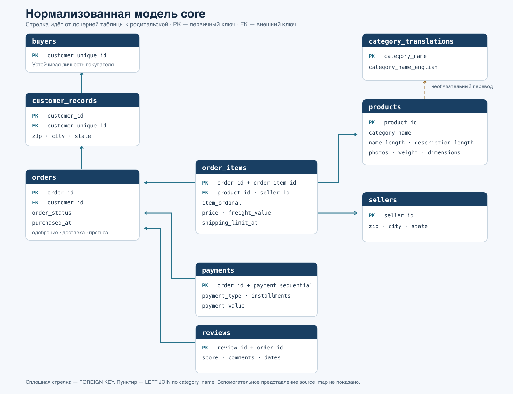

# Личная модель `core`

Рабочий комплект одного самостоятельного решения по [заданию](../handout.md). Выбран нормализованный вариант A; он реализован в [build_core.sql](../../model/build_core.sql). Коллективное сравнение пяти решений ещё не проводилось.

## Схема базы данных

На рисунке показаны таблицы и ключевые поля реализованной схемы. Сплошные стрелки соответствуют внешним ключам; пунктир показывает необязательное соединение товара с переводом категории. Полный состав полей — в [build_core.sql](../../model/build_core.sql). [Векторная версия](images/core-schema.svg).

1. [Входной запрос и рабочая оценка](working-notes.md) — контекст беседы и открытые вопросы.
2. [Журнал решений](decision-log.md) — происхождение каждого согласованного правила: вопрос, ответ, основание и источник.
3. [Требования к модели](requirements.md) — общий контракт для обоих подходов.
4. [Профиль исходных данных](data-profile.md) — проверенные особенности текущих CSV.
5. [Нормализованный подход](proposal-normalized.md) и [аналитический подход](proposal-dimensional.md) — независимые эскизы.
6. [Сравнение](comparison.md) и [ADR-0001](../adr/0001-normalized-core.md) — критерии, выбор и его причина.
7. [Ответы](answers.md), [записка](decision-note.md), [дашборд](dashboard.md), [развитие](growth.md) — материалы для сдачи.

Команды запуска, SQL и полные CSV-результаты перечислены в [личном README](../../README.md). Состав материалов соответствует [handout.md](../handout.md).
